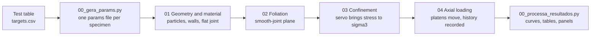

# pfc3d-schist-triaxial-test

A PFC3D workflow that reproduces **triaxial compression tests on foliated rock**. The rock matrix is a flat-jointed
bonded-particle assembly, and the foliation is a smooth-joint plane at the dip of each specimen. The Python tools
prepare the input of each specimen from a table of test results, fit the strength of the foliation plane, and compare the
simulated curves with the test curves.

> **Status: work in progress.** The code is used in an ongoing PhD research project. Known limitations are listed in
> [Limitations](#limitations). Parameters without test data are marked as such.

This repository contains **no laboratory data**. The `00_Inputs/synthetic/` folder holds a synthetic data set with a
known answer, so every Python tool can be run and checked without any real test.

## Learn it step by step

| What | Where |
| --- | --- |
| Interactive guide (open in a browser) | [`docs/index.html`](docs/index.html) |
| Notebooks, run block by block | [`notebooks/`](notebooks) |

The notebooks are executed, so GitHub shows the figures without running anything.

1. [`00_workflow_overview`](notebooks/00_workflow_overview.ipynb): the five scripts, with the real code of each block.
2. [`01_stress_on_the_plane`](notebooks/01_stress_on_the_plane.ipynb): from the applied stresses to the normal and shear stress on the plane.
3. [`02_plane_fit_and_individual_cohesion`](notebooks/02_plane_fit_and_individual_cohesion.ipynb): the common envelope, and the cohesion of each specimen. This notebook shows the approaches before v4; the fan of v4 is described [below](#the-fan-of-the-foliation-plane-v4) and is not in a notebook yet.
4. [`03_smooth_joint_law`](notebooks/03_smooth_joint_law.ipynb): the contact law of the foliation plane, in a few lines of Python.
5. [`04_reading_the_results`](notebooks/04_reading_the_results.ipynb): peak, secant modulus and equivalent friction.

## How the test is built



| Step | File | What it does |
| --- | --- | --- |
| 0 | `01_Scripts/00_Main_Run.dat` | Global parameters, the specimen to run, and the call order |
| 1 | `01_Scripts/01_Geometry_Material.dat` | Cylinder and platen walls, random packing, radius shrinking with linear contacts to relieve the initial overlap stress, then flat-joint bonds |
| 2 | `01_Scripts/02_Foliation_SJM.dat` | The plane at the specimen dip becomes a smooth-joint band |
| 3 | `01_Scripts/03_Confinement_Servo.dat` | A servo moves the lateral wall and the platens until the radial and axial stresses reach the confining target (hydrostatic stage) |
| 4 | `01_Scripts/04_Axial_Loading.dat` | Platens move at constant speed, virtual extensometers, stop rules, histories exported |
| Tools | `00_Inputs/*.py`, `03_Outputs/00_processa_resultados.py` | Parameter files, plane fit, batch runs, result processing |

### Model summary

- Specimen: cylinder, radius 32 mm and height 128.15 mm, with about 10,000 spheres (radius 1.5 to 2.25 mm).
- Matrix: PFC flat-joint contacts. The normal stiffness `p_fjkn` is set so that the simulated Young's modulus is close to the test value, with `ks/kn = 0.4`.
- Foliation: contacts within `sj_band` (2 mm) of a plane through the specimen centre become smooth-joint contacts. The cohesion, the friction angle of the bonded contact and, since v4, the residual friction come from the specimen's params file.
- Confinement: a servo brings the radial and axial stresses to the target (within 2 % for 50 checks in a row). During axial loading the lateral servo keeps the confining stress near its target.
- Loading: the platens move at 5 mm/s each.
- Stop rules: axial strain, platen strain, a drop after the first peak, or a cycle limit. See the header of `halt_axial` in the `04` script.

## The fan of the foliation plane (v4)

A triaxial test gives one point per specimen on the foliation plane, so it cannot give a cohesion `c` and a friction
angle `phi` of its own: a point lies on infinitely many Coulomb lines. Earlier versions fixed `phi` and let `c` absorb the
difference. Version 4 does not fix `phi`. Instead:

1. Each test gives one point on the plane at the peak: `sn = s3 + D cos²θ` and `tau = D sinθ cosθ` (`D` = peak
   deviatoric stress, `θ` = dip of the plane).
2. Two extreme lines `tau = c + m·sn` (`m = tan(phi)`) bound the cloud of points. Each is drawn through two **anchor**
   specimens: `a = 1` is the upper line and `a = 0` is the lower line. The anchors are the constants `ANC_CIMA` and
   `ANC_BAIXO` at the top of `00_gera_params.py` (and of `00_processa_resultados.py`; keep them equal).
3. The lines between the two form the fan: `c(a) = c0 + a·Δc` and `tan(phi(a)) = m0 + a·Δm`, with `a` from 0 to 1.
4. Each specimen gets the line of the fan that passes through its own point. Imposing the point on the line and solving for
   `a` gives `a = (tau − c0 − m0·sn) / (Δc + Δm·sn)`, the fraction of the height of the point inside the fan.
5. From `a` come `c(a)` (`p_sjcoh`), `phi(a)` (`p_sjfa`) and the residual friction `p_sjfric = tan(phi(a))`
   (before v4 it was one global value in `00_Main_Run.dat`).

A point outside the fan (`a` below 0 or above 1) keeps the common `c` and `phi`. The normal stiffness `kn` is still
calibrated from the secant modulus of each test and was not changed.

What to keep in mind when you use it:

- The fan is an empirical envelope built on four anchors. It is not a material property, and weak anchors (mixed failure,
  low confidence) weaken it.
- The link between `c` and `phi` along the fan is imposed by the construction. It is not measured.
- Any line through the point of a specimen gives the same analytical peak, so the fan changes `sj_fa` and the residual
  friction, but by construction it does not improve the peak.
- `p_sjfric = tan(phi)` is the classical hypothesis (cohesion is lost at failure and friction stays). It has not been
  checked against post-peak test data.
- The synthetic set has a single true plane (`c` = 10 MPa, `phi` = 22°) with scatter, so its fan only absorbs the scatter.
  The anchors in the code were picked by a search so that the fan contains all synthetic points. With your own data,
  choose the anchors yourself and check the figure that `01_fit_plano_foliacao.py` writes.
- `00_processa_resultados.py` shows `a`, the line used and the fan equations for a specimen only when its params file
  carries the `LEQUE a = ...` comment. Without it, it behaves as before v4.

Version history: v3.4.1 (common `c` and `phi`, optional `c` per specimen) → v3.4.2 (`c` and `kn` per specimen) → v4 (fan,
residual friction per specimen; tangent modulus 40–60 % removed from the result processing, only the secant modulus is kept).

## Quick start

### Python tools (no PFC needed)

```bash
pip install numpy pandas scipy matplotlib
cd 00_Inputs/synthetic
python make_synthetic_data.py                          # writes specimens.csv, targets.csv, curves_lab.csv
cd ..
python 00_gera_params.py --dados synthetic --saida synthetic/params                    # v4 default: fan, residual friction, kn
python 01_fit_plano_foliacao.py synthetic/params       # checks the files and draws the two plane plots (fixed phi and fan)
python 00_gera_params.py --dados synthetic --saida synthetic/params_c --individual c   # earlier approach: cohesion per specimen
python 00_gera_params.py --dados synthetic --saida synthetic/params_comum --comum      # common c, phi and kn (v3.4.1 output)
```

The synthetic plane has a true cohesion of 10 MPa and a friction angle of 22 degrees. The fixed-phi fit returns values
close to these, with the scatter that was added to the peak strengths. The fan (default) gives each synthetic specimen its
own `a`, `c`, `phi` and `p_sjfric`; the figure and `fit_plano_resumo.txt` list the equations.

### Running the model in PFC3D

PFC3D is a commercial program from Itasca and is not included. With a license:

1. Put the params files of your specimens in `00_Inputs/` (see above).
2. In `01_Scripts/00_Main_Run.dat`, set `amostra` to the specimen id and `usa_foliacao` to 1 (or 0 for a matrix-only run).
3. Run `00_Main_Run.dat` in PFC3D. The console log and the histories go to `03_Outputs/`.
4. Process the results: `python 03_Outputs/00_processa_resultados.py --dados ../00_Inputs`.

## Using your own data

`00_gera_params.py` reads `specimens.csv` and `targets.csv`. Use the files in `00_Inputs/synthetic/` as a template for the
columns. Real data files are listed in `.gitignore`, so they are not committed by accident.

## Limitations

- Sample ids follow the pattern `ITA<number>`, because the Python tools search for it. Numbers from 900 up are synthetic.
- The flat-joint strength parameters of the matrix (`fj_coh`, `fj_ten`, `fj_fa`) were not calibrated against matrix tests.
- The tensile strength of the smooth joint (`sj_ten`) and the platen friction have no test data. Their sensitivity has not been tested.
- The normal stiffness is set per specimen from the secant modulus of the test (factor limited to 0.75–1.40), using a
  reference model modulus (`E_MODELO_REF`) estimated from three runs. If it is off, all stiffnesses are off in the same
  proportion. The modulus is matched only at the secant level: the model is linear up to the peak and the test curve is S-shaped.
- Steep planes (dip above about 63 degrees) meet both rigid platens, and sliding may be restrained. This is a hypothesis under study.
- Inline comments and console messages in the PFC scripts and the Python tools are in Portuguese. The documentation is in English.

## License and citation

The license has not been chosen yet. See `CITATION.cff` for how to cite the code.
